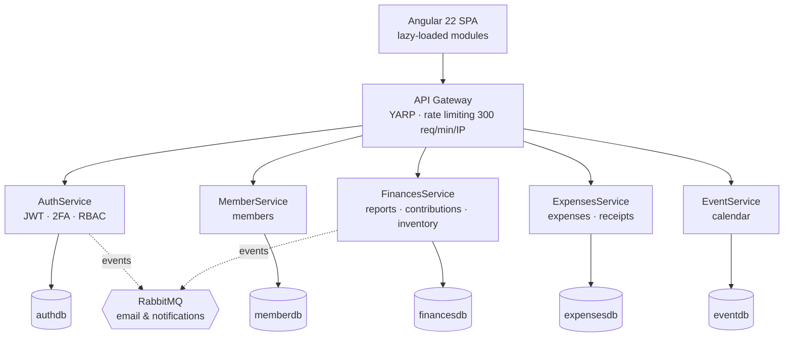

# ICM Solution — architecture & engineering showcase

Multi-tenant treasury and membership platform built for **Igreja Cristã Maranata (Portugal)**, a
non-profit organisation with multiple churches. It manages members, monthly financial reports,
contributions, expenses, purchase requests, events and inventory.

> **Why this repository exists.** The source code lives in a private repository because the system
> holds real member and financial data. This showcase documents the architecture, the
> security decisions and a few representative excerpts of the real code. I am happy to walk
> through the full codebase in an interview.

**Status:** in use by the organisation with real data. The hardened production deployment (VPS,
HTTPS via Caddy, production secrets) is in progress. Author and maintainer: [Elker Bonandi](https://github.com/Bonandi22).

---

## Architecture

Five independent services behind an API gateway, each one in Clean Architecture
(Domain → Application → Infrastructure → WebApi), with one database per service.

All services share an internal library (`ApiInfrastructure`) for JWT validation, CORS, security
headers, permissions, auditing and the base repository, so cross-cutting rules are written once.

| Service | Responsibility |
|---|---|
| **API Gateway** | Single entry point, routing, per-IP rate limiting |
| **AuthService** | Login with email 2FA, JWT issuing, users, churches, roles and permissions |
| **MemberService** | Member registry and history, membership across one or more churches |
| **FinancesService** | Monthly reports (submit → review → approve, then locked), contributions, inventory |
| **ExpensesService** | Expenses, receipt uploads, purchase requests with approval flow |
| **EventService** | Shared calendar and notifications |

## Security design

The system handles personal and financial data, so security was designed in, not added later.

| Concern | Decision |
|---|---|
| **Authentication** | JWT in `HttpOnly` cookies, mandatory email OTP on every login, forced password change on first access |
| **Passwords & tokens** | Argon2id password hashing; refresh tokens stored only as SHA-256 hashes |
| **Brute force** | Account lockout after failed attempts; per-IP rate limiting with `X-Forwarded-For` trusted only from the internal Docker network |
| **Multi-tenant isolation** | Every read and write is checked against the `churchIds` claim in the JWT, never against the church sent by the client |
| **Authorisation** | Named permissions per endpoint (`[RequirePermission]`), mapped from 7 organisational roles |
| **Mass assignment** | Write DTOs never map audit or ownership fields (church, created-by) from the client |
| **Transport & headers** | CSP, HSTS, X-Frame-Options on every service |
| **Secrets** | Environment variables only; nothing sensitive in committed configuration |
| **Disclosure** | Security policy with private reporting through GitHub Security Advisories |

Representative excerpts of the real code are in [`excerpts/`](excerpts):

- [`RequirePermissionAttribute.cs`](excerpts/RequirePermissionAttribute.cs): permission-based authorisation filter
- [`ChurchIsolation.cs`](excerpts/ChurchIsolation.cs): tenant isolation, and hiding cross-church records as "not found"
- [`CurrentUserService.cs`](excerpts/CurrentUserService.cs): reading tenant and identity claims from the JWT

## Quality & delivery

- **CI on every pull request**: restore, build and tests for all services and the frontend.
- **On merge to `master`**: 7 Docker images (5 services, gateway, frontend) published to GHCR.
- **Gates before any image is published**: tests, a check for pending EF Core model changes,
  secret scanning, and a **fail-closed dependency audit** for NuGet and npm (the build fails on
  known vulnerabilities, and also when the audit itself cannot complete).
  Recent work brought frontend vulnerabilities from **20 to 0** (including replacing `xlsx` with
  `exceljs`) and upgraded the frontend to **Angular 22**.
- **Accessibility**: WCAG 2.2 AA fixes across the frontend.
- **Tests**: xUnit, Moq and FluentAssertions per service.
- **Workflow**: issue → branch → PR with a security checklist (permissions, cross-church isolation,
  mass assignment, secrets) → green checks → squash merge.

## Architecture decisions (ADRs)

Decisions are recorded as ADRs (context, decision, alternatives, consequences):

| ADR | Decision |
|---|---|
| 0001 | .NET 10 LTS with the SDK pinned in `global.json` |
| 0002 | Explicit mapping instead of AutoMapper |
| 0003 | ASP.NET Core types only from the shared framework; no legacy 2.x packages |
| 0004 | Unique-constraint violations become a generic 409, classified by error code |
| 0005 | Quality gates in CI, adopted one at a time |
| 0006 | Generic repository + Unit of Work with auditing (existing decision, recorded) |

## Tech stack

| Layer | Technologies |
|---|---|
| Backend | .NET 10 (LTS), ASP.NET Core, Entity Framework Core, SQL Server 2022 |
| Security | JWT (`HttpOnly` cookies), Argon2id, SHA-256 refresh tokens, email OTP |
| Messaging | RabbitMQ |
| Gateway | YARP |
| Frontend | Angular 22, Angular Material, Chart.js |
| Delivery | Docker, Docker Compose, GitHub Actions, GHCR, Dependabot |
